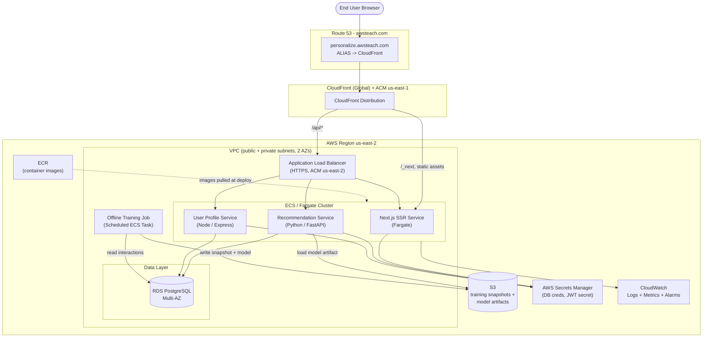
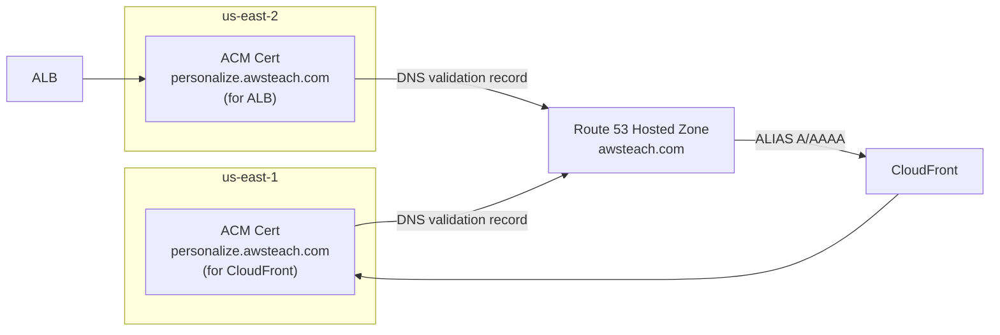
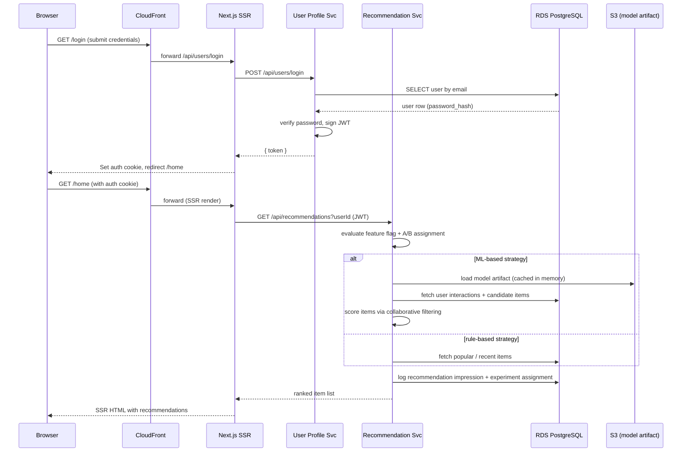
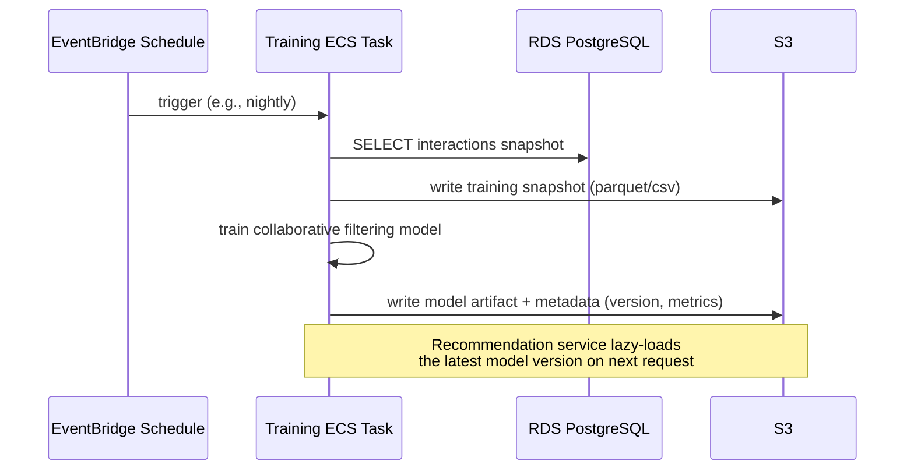
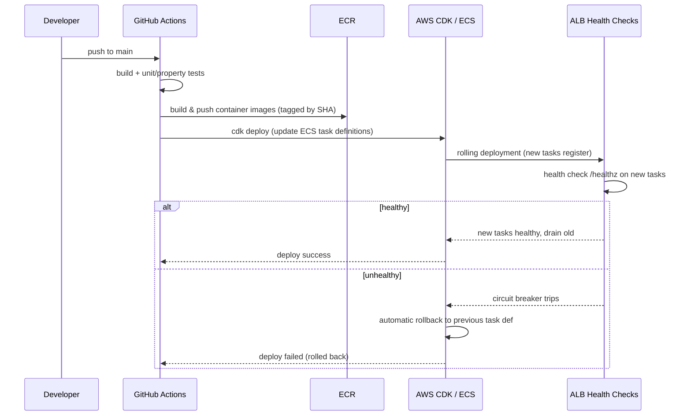
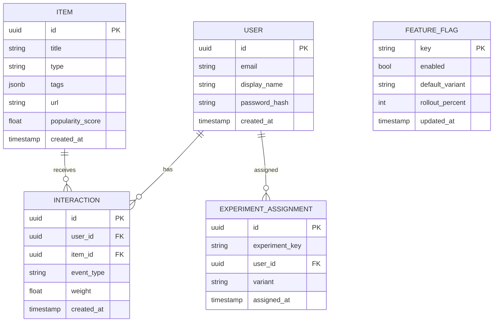
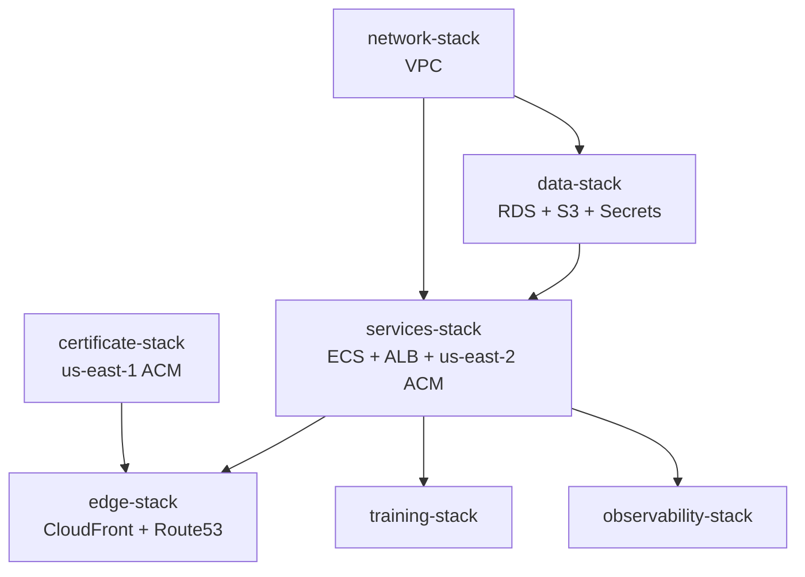
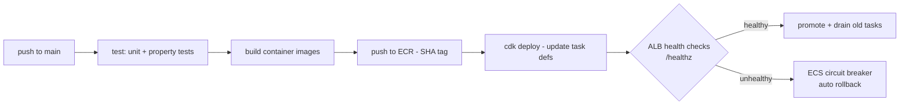

# Design Document: Personalization Hub (Recommendations)

## Overview

Personalization Hub is an enterprise-quality content recommendation application built as a teaching example for a Machine Learning Engineering class. Authenticated users log into a mini "GoTo learning center" and see personalized recommendations for content items (articles, videos, internal docs). The system demonstrates modern ML engineering practices: a microservices backend, an offline-trained collaborative filtering model with online inference, feature flags to toggle recommendation strategies, A/B testing infrastructure, and a full CI/CD pipeline.

The application is deployed **entirely on AWS** (region `us-east-2`) and is fully self-hosted — after deployment, the local chat/build server can be turned off and the application continues running with no local dependencies. The frontend is a server-side-rendered (SSR) Next.js app served through CloudFront; backend microservices run on ECS/Fargate behind an Application Load Balancer (ALB); PostgreSQL data lives in Amazon RDS; and S3 stores training-data snapshots and model artifacts. All infrastructure is defined as code with **AWS CDK (TypeScript)** for reproducible, one-command deployment.

The application is served over HTTPS at `personalize.awsteach.com` using ACM certificates and Route 53 records in the existing `awsteach.com` hosted zone. The reserved name `www.awsteach.com` is never used.

---

## Architecture

### High-Level System Architecture



### Certificate & Region Strategy

CloudFront requires its ACM certificate to be issued in **`us-east-1`**, while regional resources such as the ALB require an ACM certificate in the deployment region **`us-east-2`**. The design provisions two certificates for the same domain:



Both certificates use DNS validation against the `awsteach.com` hosted zone. CDK creates the validation `CNAME` records automatically. Because CDK deploys per-region, the certificates are provisioned as a **cross-region stack** (the us-east-1 certificate is created in a dedicated stack with `crossRegionReferences` enabled, then referenced by the CloudFront stack).

### Request Routing

- `personalize.awsteach.com` resolves via a Route 53 **ALIAS** record to the CloudFront distribution.
- CloudFront has two origins:
  - **Default behavior** and static asset paths (`/_next/static/*`, `/assets/*`) → forwarded to the ALB → Next.js SSR service. Static assets are cached; SSR/HTML responses use short or no cache.
  - **`/api/*` behavior** → forwarded to the ALB with caching disabled and all headers/cookies forwarded (for auth). The ALB path-routes `/api/recommendations/*` to the Recommendation service and `/api/users/*` / `/api/profile/*` to the User Profile service.

### Network / Security Boundaries

- **VPC** spanning 2 Availability Zones with public subnets (ALB, NAT gateways) and private subnets (Fargate tasks, RDS).
- Fargate services run in **private subnets**; outbound internet (image pulls at runtime, AWS API calls) via NAT gateway or VPC endpoints.
- **RDS** is in isolated/private subnets, reachable only from the service security group.
- Security groups: ALB SG allows 443 from CloudFront/Internet; service SG allows traffic only from ALB SG; RDS SG allows 5432 only from service SG.
- Secrets (DB credentials, JWT signing key) are stored in **Secrets Manager** and injected into tasks at runtime — never baked into images.

---

## Sequence Diagrams

### Login and Recommendation Fetch



### Offline Training Job



### CI/CD Deploy with Health Check and Rollback



---

## Components and Interfaces

### Component 1: Next.js SSR Frontend

**Purpose**: Server-side-rendered web UI for login, home/recommendations, and item detail. Runs as a Fargate service (not a static export) so SSR runs on AWS, not the local server.

**Responsibilities**:
- Render authenticated pages with recommendations fetched server-side.
- Manage auth session via HTTP-only cookie holding the JWT.
- Proxy/call backend APIs through the ALB.
- Expose `/healthz` for ALB health checks.

**Interface (server-side data functions)**:
```typescript
interface FrontendServer {
  // Called during SSR to render the home page
  getServerSideProps(ctx: RequestContext): Promise<{ props: HomePageProps }>;
  // Health endpoint for ALB target group
  healthz(): { status: "ok"; version: string };
}

interface HomePageProps {
  user: UserProfile;
  recommendations: RecommendedItem[];
  strategy: "rule-based" | "ml-based"; // shown as a teaching indicator
  experimentVariant: string | null;
}
```

### Component 2: User Profile Service (Node / Express, TypeScript)

**Purpose**: Owns user identity, authentication, and profile data.

**Responsibilities**:
- Register/login users, hash & verify passwords, issue & validate JWTs.
- Serve and update user profile and preferences.
- Provide user lookups to the Recommendation service (via internal call or shared DB read).
- Expose `/healthz`.

**Interface**:
```typescript
interface UserProfileService {
  register(input: RegisterInput): Promise<AuthResult>;
  login(input: LoginInput): Promise<AuthResult>;
  getProfile(userId: string): Promise<UserProfile>;
  updateProfile(userId: string, patch: ProfilePatch): Promise<UserProfile>;
  verifyToken(token: string): Promise<TokenClaims>;
}

type AuthResult =
  | { success: true; token: string; user: UserProfile }
  | { success: false; error: string };
```

### Component 3: Recommendation Service (Python / FastAPI)

**Purpose**: Produces ranked recommendations, applies feature flags and A/B assignment, records impressions, and serves online inference from the trained model.

**Responsibilities**:
- Resolve the active recommendation strategy per user via feature flag + A/B experiment assignment.
- Compute ML-based recommendations (collaborative filtering) using the latest model artifact loaded from S3.
- Compute rule-based recommendations (popularity/recency) as fallback and as the A/B control.
- Log impressions, clicks, and experiment assignments to RDS for metric comparison.
- Expose `/healthz`.

**Interface**:
```python
class RecommendationService:
    def get_recommendations(self, user_id: str, limit: int = 10) -> RecommendationResponse: ...
    def record_interaction(self, event: InteractionEvent) -> None: ...
    def reload_model(self) -> ModelMetadata: ...  # loads latest artifact from S3
    def healthz(self) -> dict: ...
```

### Component 4: Offline Training Job (Python, Scheduled ECS Task)

**Purpose**: Periodically trains the collaborative filtering model from interaction history and publishes a versioned artifact to S3.

**Responsibilities**:
- Snapshot interaction data from RDS to S3 (reproducibility).
- Train the model; evaluate holdout metrics (e.g., recall@k).
- Write versioned model artifact + metadata JSON to S3.
- Emit training metrics to CloudWatch.

**Interface**:
```python
class TrainingJob:
    def run(self) -> ModelMetadata: ...
    def snapshot_interactions(self) -> str: ...          # returns S3 key
    def train(self, snapshot_key: str) -> Model: ...
    def evaluate(self, model: Model) -> dict: ...          # metrics
    def publish(self, model: Model, metrics: dict) -> ModelMetadata: ...
```

---

## Data Models

All persistent data lives in RDS PostgreSQL. Model artifacts and snapshots live in S3.

### Model: User

```typescript
interface User {
  id: string;              // UUID, PK
  email: string;           // unique
  displayName: string;
  passwordHash: string;    // bcrypt/argon2
  createdAt: string;       // ISO timestamp
}
```
**Validation Rules**:
- `email` unique, valid email format.
- `passwordHash` never returned in API responses.
- `displayName` 1–100 chars.

### Model: Item

```typescript
interface Item {
  id: string;                     // UUID, PK
  title: string;
  type: "article" | "video" | "doc";
  tags: string[];
  url: string;
  popularityScore: number;        // denormalized, updated by rule-based job
  createdAt: string;
}
```
**Validation Rules**:
- `type` restricted to enum values.
- `url` valid absolute URL.

### Model: Interaction

```typescript
interface Interaction {
  id: string;                                  // UUID, PK
  userId: string;                              // FK -> User
  itemId: string;                              // FK -> Item
  eventType: "view" | "click" | "complete";
  weight: number;                              // implicit-feedback weight
  createdAt: string;
}
```
**Validation Rules**:
- `weight` > 0; mapped from `eventType` (e.g., view=1, click=3, complete=5).
- `(userId, itemId, createdAt)` used to build the implicit-feedback matrix.

### Model: FeatureFlag

```typescript
interface FeatureFlag {
  key: string;             // PK, e.g., "recommendation_strategy"
  enabled: boolean;        // master on/off
  defaultVariant: string;  // e.g., "rule-based"
  rolloutPercent: number;  // 0–100, % of users on the non-default variant
  updatedAt: string;
}
```
**Validation Rules**:
- `rolloutPercent` in [0, 100].
- `key` unique.

### Model: ExperimentAssignment

```typescript
interface ExperimentAssignment {
  id: string;              // UUID, PK
  experimentKey: string;   // e.g., "rec_strategy_ab"
  userId: string;          // FK -> User
  variant: string;         // "control" (rule-based) | "treatment" (ml-based)
  assignedAt: string;
}
```
**Validation Rules**:
- `(experimentKey, userId)` unique — an assignment is sticky per user.
- `variant` recorded once and reused for consistent user experience and metric attribution.

### Model: ModelMetadata (S3 JSON alongside artifact)

```typescript
interface ModelMetadata {
  version: string;         // e.g., "2024-06-01T02:00:00Z" or semantic version
  artifactKey: string;     // S3 key of serialized model
  algorithm: string;       // "implicit-als" | "item-knn"
  trainedAt: string;
  metrics: { recallAtK: number; k: number; numUsers: number; numItems: number };
}
```

### Database Schema (relationships)



---

## Low-Level Design

### Core Interfaces/Types (Recommendation Service)

```python
from dataclasses import dataclass
from typing import Literal, Optional

Strategy = Literal["rule-based", "ml-based"]

@dataclass
class RecommendedItem:
    item_id: str
    title: str
    score: float
    reason: str  # teaching aid: why this item was recommended

@dataclass
class RecommendationResponse:
    user_id: str
    strategy: Strategy
    experiment_variant: Optional[str]
    items: list[RecommendedItem]

@dataclass
class InteractionEvent:
    user_id: str
    item_id: str
    event_type: Literal["view", "click", "complete"]
```

### Key Functions with Formal Specifications

#### Function: get_recommendations()

```python
def get_recommendations(user_id: str, limit: int = 10) -> RecommendationResponse
```

**Preconditions:**
- `user_id` is a valid, existing user UUID.
- `limit` is a positive integer, `1 <= limit <= 100`.
- Feature flag `recommendation_strategy` exists in the store.

**Postconditions:**
- Returns a `RecommendationResponse` with `len(items) <= limit`.
- `items` are sorted by `score` in descending order.
- No item appears more than once in `items`.
- Every returned `item_id` refers to an existing, active `Item`.
- The chosen `strategy` matches the resolved feature-flag / A/B assignment for `user_id`.
- Exactly one impression record and (if newly assigned) one `ExperimentAssignment` are written.

**Loop Invariants (scoring loop):** After processing each candidate item, the working result set contains only distinct items whose scores have been computed with the same model version.

#### Function: resolve_strategy()

```python
def resolve_strategy(user_id: str, flag: FeatureFlag) -> tuple[Strategy, Optional[str]]
```

**Preconditions:**
- `flag` is a well-formed `FeatureFlag` with `0 <= rollout_percent <= 100`.

**Postconditions:**
- If `flag.enabled` is `false`, returns `(flag.default_variant, None)` (no experiment).
- Otherwise returns a deterministic `(strategy, variant)` for a given `user_id` — the same user always resolves to the same variant (sticky assignment).
- The proportion of users assigned to the treatment variant approximates `rollout_percent / 100` over a large user population.

**Loop Invariants:** N/A.

#### Function: score_items_ml()

```python
def score_items_ml(user_id: str, candidates: list[str], model: Model) -> list[RecommendedItem]
```

**Preconditions:**
- `model` is a loaded, non-null model artifact.
- `candidates` contains only existing item IDs.

**Postconditions:**
- Returns one `RecommendedItem` per candidate the model can score.
- Scores are finite real numbers (no NaN/Inf).
- Ordering is deterministic given identical `(user_id, candidates, model)`.

**Loop Invariants:** All previously scored items retain their computed score; the candidate set is never mutated.

### Algorithmic Pseudocode

#### Recommendation Retrieval (main workflow)

```pascal
ALGORITHM getRecommendations(user_id, limit)
INPUT: user_id (UUID), limit (positive integer <= 100)
OUTPUT: RecommendationResponse

BEGIN
  ASSERT userExists(user_id) = true
  ASSERT 1 <= limit AND limit <= 100

  flag        <- featureStore.get("recommendation_strategy")
  (strategy, variant) <- resolveStrategy(user_id, flag)

  IF variant IS NOT NULL THEN
    persistExperimentAssignmentIfAbsent(user_id, "rec_strategy_ab", variant)
  END IF

  candidates <- database.getCandidateItems(user_id)   // exclude already-completed items

  IF strategy = "ml-based" THEN
    model  <- modelCache.getLatest()                   // lazy-load from S3 if stale
    scored <- scoreItemsML(user_id, candidates, model)
  ELSE
    scored <- scoreItemsRuleBased(candidates)          // popularity + recency
  END IF

  ranked <- sortDescendingByScore(scored)
  top    <- take(ranked, limit)

  ASSERT isDistinct(top) AND isSortedDescending(top) AND length(top) <= limit

  recordImpression(user_id, top, strategy, variant)

  RETURN RecommendationResponse(user_id, strategy, variant, top)
END
```

**Preconditions:** `user_id` valid; `limit` in range; feature flag present.
**Postconditions:** distinct, score-sorted list of at most `limit` items; impression recorded; strategy consistent with assignment.
**Loop Invariants:** scoring preserves distinctness and uses a single model version.

#### Deterministic Feature Flag + A/B Assignment

```pascal
ALGORITHM resolveStrategy(user_id, flag)
INPUT: user_id (UUID), flag (FeatureFlag)
OUTPUT: (strategy, variant)

BEGIN
  IF flag.enabled = false THEN
    RETURN (flag.default_variant, NULL)
  END IF

  // Deterministic, sticky bucketing: same user always maps to same bucket
  h      <- stableHash(flag.key + ":" + user_id)   // e.g., SHA-256 -> integer
  bucket <- h MOD 100                               // bucket in [0, 99]

  IF bucket < flag.rollout_percent THEN
    RETURN ("ml-based", "treatment")
  ELSE
    RETURN ("rule-based", "control")
  END IF
END
```

**Preconditions:** `flag` well-formed; `0 <= rollout_percent <= 100`.
**Postconditions:** deterministic per user; treatment fraction approximates `rollout_percent%`.

#### Collaborative Filtering (Implicit-Feedback ALS) — Training

The offline model uses **Alternating Least Squares (ALS)** over the implicit-feedback matrix. Each observed interaction contributes a confidence weight; unobserved pairs get low confidence.

```pascal
ALGORITHM trainALS(interactions, num_factors, iterations, lambda, alpha)
INPUT:
  interactions : list of (user, item, weight)
  num_factors  : positive integer (latent dimension)
  iterations   : positive integer
  lambda       : regularization > 0
  alpha        : confidence scaling > 0
OUTPUT: (U, V)   // user-factor and item-factor matrices

BEGIN
  R  <- buildSparseMatrix(interactions)        // preference proxy
  C  <- 1 + alpha * R                          // confidence matrix
  P  <- indicator(R > 0)                        // binary preference

  U  <- randomMatrix(num_users, num_factors)
  V  <- randomMatrix(num_items, num_factors)

  FOR iter FROM 1 TO iterations DO
    ASSERT dimensions(U) = (num_users, num_factors)
    ASSERT dimensions(V) = (num_items, num_factors)

    // Fix V, solve for each user's factor vector
    FOR each user u DO
      U[u] <- solveRidge(V, C[u], P[u], lambda)
    END FOR

    // Fix U, solve for each item's factor vector
    FOR each item i DO
      V[i] <- solveRidge(U, C[:,i], P[:,i], lambda)
    END FOR
  END FOR

  RETURN (U, V)
END
```

**Preconditions:** at least one positive interaction exists; hyperparameters positive.
**Postconditions:** `U`, `V` have finite entries; predicted score for `(u, i)` is `U[u] · V[i]`.
**Loop Invariants:** After each iteration, `U` and `V` retain shapes `(num_users × num_factors)` and `(num_items × num_factors)`; each ridge solve reduces (or holds) the regularized squared error.

#### Online Inference (ML scoring)

```pascal
ALGORITHM scoreItemsML(user_id, candidates, model)
INPUT: user_id, candidates (list of item ids), model (U, V, index maps)
OUTPUT: list of RecommendedItem

BEGIN
  IF NOT model.hasUser(user_id) THEN
    RETURN []          // cold-start user -> caller falls back to rule-based
  END IF

  u_vec  <- model.U[ model.userIndex(user_id) ]
  result <- empty list

  FOR each item_id IN candidates DO
    ASSERT isDistinct(result)
    IF model.hasItem(item_id) THEN
      i_vec <- model.V[ model.itemIndex(item_id) ]
      score <- dotProduct(u_vec, i_vec)
      ASSERT isFinite(score)
      result.append( RecommendedItem(item_id, score, reason="collaborative filtering") )
    END IF
  END FOR

  RETURN result
END
```

**Preconditions:** model loaded; candidates are valid item IDs.
**Postconditions:** finite scores; deterministic order for fixed inputs; input list unmodified.
**Loop Invariants:** `result` stays distinct; `candidates` never mutated.

#### Rule-Based Scoring (control / fallback)

```pascal
ALGORITHM scoreItemsRuleBased(candidates)
INPUT: candidates (list of Item)
OUTPUT: list of RecommendedItem

BEGIN
  now    <- currentTime()
  result <- empty list
  FOR each item IN candidates DO
    recency <- 1 / (1 + ageInDays(item.createdAt, now))
    score   <- item.popularityScore * 0.7 + recency * 0.3
    result.append( RecommendedItem(item.id, score, reason="popular + recent") )
  END FOR
  RETURN result
END
```

### API Endpoint Signatures

All endpoints are served behind `personalize.awsteach.com/api/*` via ALB path routing. Authenticated endpoints require the JWT (HTTP-only cookie or `Authorization: Bearer`).

**User Profile Service** (`/api/users`, `/api/profile`)

```
POST   /api/users/register     body: { email, password, displayName }         -> 201 { token, user }
POST   /api/users/login        body: { email, password }                       -> 200 { token, user } | 401
GET    /api/profile            auth                                            -> 200 { user }
PATCH  /api/profile            auth  body: { displayName?, preferences? }      -> 200 { user }
GET    /healthz                                                                -> 200 { status, version }
```

**Recommendation Service** (`/api/recommendations`, `/api/interactions`)

```
GET    /api/recommendations    auth  query: { limit? }                         -> 200 RecommendationResponse
POST   /api/interactions       auth  body: { itemId, eventType }               -> 202 (accepted)
GET    /api/experiments/metrics auth (admin)                                   -> 200 { byVariant: [...] }
POST   /admin/model/reload     auth (admin)                                    -> 200 ModelMetadata
GET    /healthz                                                                -> 200 { status, version }
```

**A/B Metrics query (teaching point)** — compares click-through rate by variant:

```sql
SELECT ea.variant,
       COUNT(DISTINCT i.user_id)                            AS users,
       SUM(CASE WHEN i.event_type = 'click' THEN 1 ELSE 0 END)::float
         / NULLIF(SUM(CASE WHEN i.event_type = 'view' THEN 1 ELSE 0 END), 0) AS ctr
FROM experiment_assignment ea
JOIN interaction i ON i.user_id = ea.user_id
WHERE ea.experiment_key = 'rec_strategy_ab'
GROUP BY ea.variant;
```

### Example Usage

```python
# Recommendation service request handling (FastAPI)
@app.get("/api/recommendations")
def recommendations(user_id: str = Depends(auth), limit: int = 10):
    return service.get_recommendations(user_id=user_id, limit=limit)

# Feature flag toggle at runtime (admin) flips strategy without redeploy
feature_store.update("recommendation_strategy", enabled=True, rollout_percent=50)

# Cold-start user: ML returns empty -> service falls back to rule-based
resp = service.get_recommendations(user_id="new-user-123", limit=10)
assert resp.strategy in ("rule-based", "ml-based")
assert len(resp.items) <= 10
```

```typescript
// Next.js SSR page fetches recommendations server-side (runs on Fargate, not locally)
export async function getServerSideProps(ctx: RequestContext) {
  const token = ctx.req.cookies["auth"];
  const res = await fetch(`${INTERNAL_API}/api/recommendations?limit=10`, {
    headers: { Authorization: `Bearer ${token}` },
  });
  const recommendations = await res.json();
  return { props: { recommendations } };
}
```

---

## Infrastructure as Code (IaC)

**Recommended tool: AWS CDK (TypeScript).** CDK is chosen because it lets an AI coding agent express the full stack in a typed language, share types with the app, and deploy with a single `cdk deploy` — making the deployment reproducible and fully self-hosted so the local server can be shut down afterward. Terraform is a valid alternative; CDK is preferred here for tight integration with TypeScript app code and native cross-region certificate handling.

### Stack Structure

```
infra/                          (AWS CDK app, TypeScript)
  bin/app.ts                    // CDK app entry; wires stacks, sets env=us-east-2
  lib/
    certificate-stack.ts        // us-east-1 ACM cert for CloudFront (crossRegionReferences)
    network-stack.ts            // VPC, subnets, NAT, security groups
    data-stack.ts               // RDS PostgreSQL (Multi-AZ), Secrets Manager, S3 buckets
    services-stack.ts           // ECS cluster, ALB, Fargate services (FE, rec, user), us-east-2 ACM
    edge-stack.ts               // CloudFront distribution + Route 53 ALIAS records
    training-stack.ts           // EventBridge schedule + Fargate task definition for training
    observability-stack.ts      // CloudWatch dashboards, alarms, log groups
  cdk.json
```

### Deployment Ordering



### Key IaC Concerns

- **Cross-region certificate**: `certificate-stack` deploys to `us-east-1`; `edge-stack` references it via `crossRegionReferences: true`. `services-stack` creates a separate ACM cert in `us-east-2` for the ALB.
- **DNS**: Route 53 `ARecord` (ALIAS) for `personalize.awsteach.com` → CloudFront. ACM DNS-validation records auto-created in the `awsteach.com` hosted zone (looked up via `HostedZone.fromLookup`). No record touches `www.awsteach.com`.
- **Images**: Built and pushed to ECR by CI; Fargate task definitions reference immutable SHA-tagged images.
- **Secrets**: RDS credentials and JWT signing key generated in Secrets Manager and injected as ECS secrets — never in source or images.
- **Self-hosted guarantee**: Every runtime component (SSR, APIs, DB, model store, training, DNS, CDN) is an AWS-managed resource. After `cdk deploy` succeeds and CI has pushed images, the local server has no runtime role and can be turned off.

---

## CI/CD Pipeline

**GitHub Actions → ECR → CDK/ECS deploy**, with ALB health checks and automatic rollback.



**Pipeline stages:**
1. **Test**: run unit and property-based tests for both services; fail fast.
2. **Build & Push**: build Docker images for frontend, recommendation, user-profile, and training; push to ECR tagged with commit SHA.
3. **Deploy**: `cdk deploy` updates ECS task definitions to the new image tags.
4. **Health & Rollback**: ECS deployment uses a **deployment circuit breaker** with rollback enabled; ALB target-group health checks hit `/healthz`. If new tasks fail health checks, ECS automatically rolls back to the last stable task definition.
5. **OIDC auth**: GitHub Actions authenticates to AWS via OIDC role assumption (no long-lived keys stored in GitHub).

---

## Correctness Properties

These are the invariants that must hold for the system; they drive property-based tests during implementation.

> Note: This is a design-first spec. The requirement references below (e.g., Requirements 3.1) point to requirements that will be formalized in the requirements phase derived from this design.

### Property 1: Recommendation cardinality
For all valid `user_id` and `limit` in `[1,100]`, `get_recommendations` returns at most `limit` items.
**Validates: Requirements 3.1**

### Property 2: Distinctness
For all responses, no `item_id` appears more than once.
**Validates: Requirements 3.2**

### Property 3: Ordering
For all responses, `items` are sorted by `score` in non-increasing order.
**Validates: Requirements 3.3**

### Property 4: Validity
For all returned items, the `item_id` corresponds to an existing item, and the user has not already "completed" that item.
**Validates: Requirements 3.4**

### Property 5: Sticky assignment
For all users, repeated calls to `resolve_strategy` with the same flag yield the same `(strategy, variant)`.
**Validates: Requirements 4.1**

### Property 6: Rollout proportionality
Over a large random user set, the fraction assigned to `treatment` approximates `rollout_percent / 100`.
**Validates: Requirements 5.1**

### Property 7: Flag off
When `flag.enabled = false`, all users receive `default_variant` and no experiment assignment is created.
**Validates: Requirements 4.2**

### Property 8: Finite scores
For all ML-scored items, the score is a finite real number (no NaN/Inf).
**Validates: Requirements 3.5**

### Property 9: Cold-start fallback
For a user unknown to the model, ML scoring returns empty and the system falls back to rule-based, still satisfying properties 1–4.
**Validates: Requirements 3.6**

### Property 10: Idempotent assignment
Recording an experiment assignment twice for the same `(experiment_key, user_id)` does not create a duplicate row.
**Validates: Requirements 5.2**

---

## Error Handling

### Scenario: Model artifact unavailable or corrupt
**Condition**: Recommendation service cannot load a valid model from S3.
**Response**: Log error to CloudWatch; automatically serve rule-based recommendations.
**Recovery**: Retry lazy-load on next request; alarm fires if failures persist.

### Scenario: RDS unavailable
**Condition**: Database connection fails.
**Response**: Return `503` with a retry hint; health check fails so ALB stops routing to unhealthy tasks.
**Recovery**: Multi-AZ RDS failover; ECS keeps tasks until DB recovers.

### Scenario: Invalid/expired JWT
**Condition**: Auth token missing, malformed, or expired.
**Response**: `401 Unauthorized`; frontend redirects to `/login`.
**Recovery**: User re-authenticates.

### Scenario: Deployment health-check failure
**Condition**: New task revision fails `/healthz`.
**Response**: ECS deployment circuit breaker trips.
**Recovery**: Automatic rollback to previous stable task definition.

### Scenario: ACM/DNS validation delay
**Condition**: Certificate not yet validated at deploy time.
**Response**: CDK waits on DNS validation; deploy blocks until issued.
**Recovery**: Validation records exist in the hosted zone; issuance completes automatically.

---

## Testing Strategy

### Unit Testing Approach
- Recommendation service (Python): test `resolve_strategy`, `score_items_ml`, `score_items_rule_based`, ranking/dedup logic. Framework: `pytest`.
- User profile service (Node/TS): test auth, password hashing/verification, JWT issue/verify, profile updates. Framework: `jest` or `vitest`.

### Property-Based Testing Approach
Property-based tests encode the Correctness Properties above.
**Property Test Library**: `hypothesis` (Python) for the recommendation service; `fast-check` (TypeScript) for the user-profile service and shared logic.

Example properties to implement:
- Generate random users/limits → assert cardinality, distinctness, ordering (properties 1–3).
- Generate random flags/users → assert sticky assignment and rollout proportionality (properties 5–6).
- Generate cold-start users → assert fallback correctness (property 9).

### Integration Testing Approach
- Spin up ephemeral RDS (or containerized Postgres) and run the services against it to validate end-to-end recommendation + interaction logging.
- Smoke test post-deploy: hit `personalize.awsteach.com/healthz` and `/api/recommendations` through CloudFront to confirm the fully self-hosted path works with the local server off.

---

## Observability

- **CloudWatch Logs**: structured logs from all Fargate services and the training job.
- **CloudWatch Metrics & Alarms**: ALB 5xx rate, target health, RDS CPU/connections, ECS task failures, model-load failures, training success/failure.
- **Dashboards**: request latency, recommendation strategy distribution (rule-based vs ml-based), A/B CTR by variant (teaching visualization).
- **Tracing (optional teaching extension)**: AWS X-Ray across ALB → services for request tracing.

---

## Security Considerations

- **Secrets**: DB credentials and JWT signing key in Secrets Manager, injected at runtime.
- **Network isolation**: services and RDS in private subnets; RDS reachable only from service SG.
- **Transport security**: HTTPS end-to-end (CloudFront ACM us-east-1; ALB ACM us-east-2); HTTP redirected to HTTPS.
- **AuthN/AuthZ**: JWT-based sessions; admin endpoints (`/admin/model/reload`, metrics) require an admin claim.
- **CI/CD**: GitHub Actions uses OIDC role assumption — no long-lived AWS keys in the repo.
- **Least privilege**: task roles scoped to the specific S3 buckets, Secrets, and RDS resources they use.
- **Password storage**: hashed with bcrypt/argon2; never logged or returned.

---

## Performance Considerations

- **Model caching**: recommendation service caches the loaded model in memory; reloads only when a newer artifact version appears in S3.
- **CloudFront caching**: static assets cached at edge; SSR/API responses bypass cache.
- **Candidate limiting**: scoring is bounded to a candidate set (recent/popular pool), keeping online inference O(#candidates × factors).
- **RDS connection pooling** per service; read patterns tuned for the metrics query.
- **Fargate autoscaling**: target-tracking on CPU/requests for the SSR and recommendation services.

---

## Dependencies

- **AWS**: CloudFront, ACM (us-east-1 + us-east-2), Route 53 (`awsteach.com`), ECS/Fargate, ECR, ALB, RDS PostgreSQL, S3, Secrets Manager, CloudWatch, EventBridge, IAM.
- **IaC**: AWS CDK (TypeScript).
- **Frontend**: Next.js (SSR), React, TypeScript.
- **User Profile Service**: Node.js, Express, TypeScript, JWT library, bcrypt/argon2.
- **Recommendation & Training**: Python, FastAPI, `implicit` or NumPy/SciPy (ALS), pandas, boto3.
- **CI/CD**: GitHub Actions with AWS OIDC.
- **Testing**: pytest + hypothesis (Python); jest/vitest + fast-check (TypeScript).

---

## Addendum: Generative AI Enhancement and Insights App

This addendum documents functionality added after the initial deployment to make the demo a genuine "Generative AI Development on AWS" teaching example.

### LLM-enhanced recommendation strategy (Personalization Hub)

A third recommendation strategy, `llm-enhanced`, was added alongside `rule-based` and `ml-based`:

- The A/B **treatment** group now receives `llm-enhanced` (configurable via the `TREATMENT_STRATEGY` env var); **control** remains `rule-based`.
- `llm-enhanced` starts from the ML (ALS) ranking, then calls **Amazon Bedrock** (`us.anthropic.claude-haiku-4-5-20251001-v1:0`, an inference profile) via the Converse API to generate a short, personalized natural-language explanation for each recommended item, grounded in the user's recent activity.
- Cold-start users (unknown to the ML model) fall back to rule-based ranking; LLM failures fall back to the base `reason` string.
- **Reasoning logging:** every prompt/response (system prompt, user prompt, response, latency, token counts) is written to the CloudWatch log group `/personalization-hub/llm-reasoning`. No secrets are logged.
- IAM: the recommendation task role is granted `bedrock:InvokeModel`/`bedrock:Converse` and write access to the reasoning log group.

### Insights App (serverless companion)

A separate, fully serverless application (`PhInsights` stack) provides students insight into the deployment:

- **Static frontend in S3** (public website bucket): a chat UI plus a live "LLM Reasoning Logs" panel.
- **Dynamic content via Lambda** behind an HTTP API (API Gateway v2):
  - **Chatbot Lambda** (Python): answers questions using Bedrock (Claude Haiku 4.5), grounded in `projectknowledge.md` read from an S3 knowledge bucket. When asked about logs/prompts/reasoning, it also fetches recent reasoning records and passes them to the model. Its own prompts/responses are logged to `/personalization-hub/chatbot-reasoning`.
  - **Logs Lambda** (Python): returns recent reasoning records from both log groups as structured JSON, with sensitive fields redacted.
- **Knowledge base:** `projectknowledge.md` in S3, kept updated with design/deployment details and containing no secrets.
- **Link:** the Personalization Hub home page links to the Insights App (`INSIGHTS_URL` env var injected into the SSR frontend).
- Static site files and the knowledge base are uploaded to S3 at deploy time via the AWS CLI (the CDK `BucketDeployment` custom resource failed to read assets in this account, so direct CLI upload is used instead — more robust and with no runtime dependency).

### Model choice note

On-demand invocation of Claude base model ids is not supported in this account; invocation requires an **inference profile** (e.g. `us.anthropic.claude-haiku-4-5-20251001-v1:0`). Both the recommendation explainer and the chatbot use this profile.
